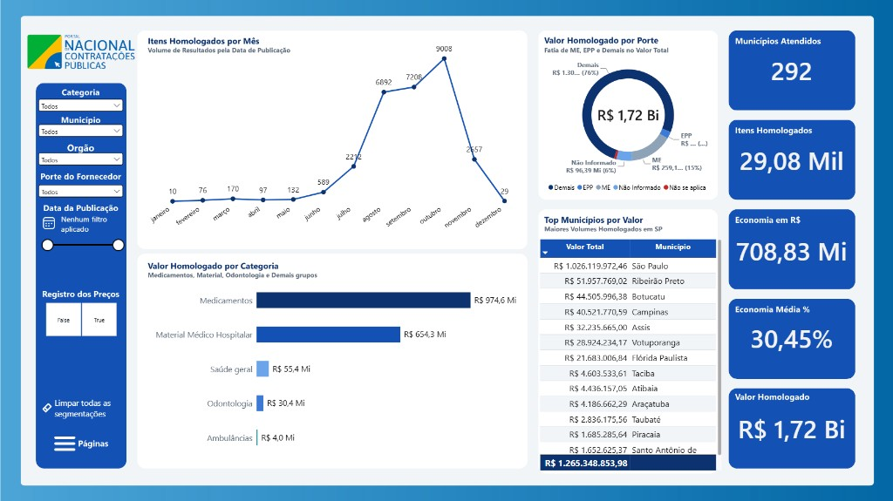
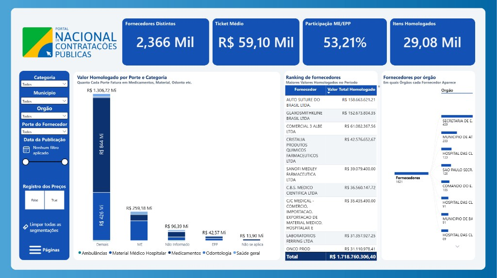
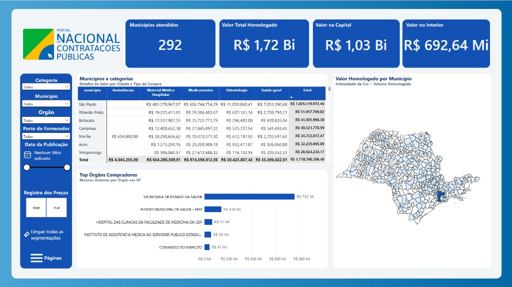
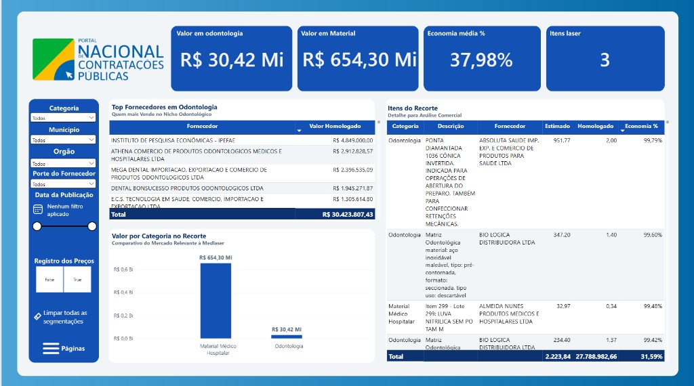
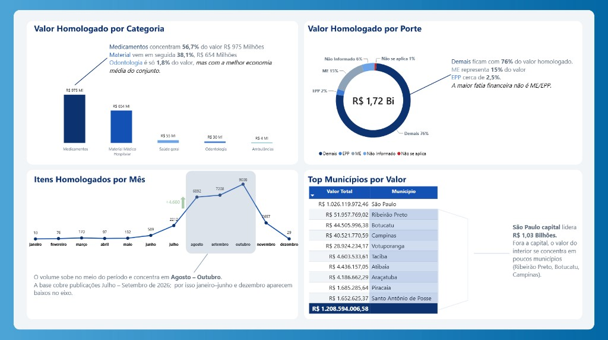
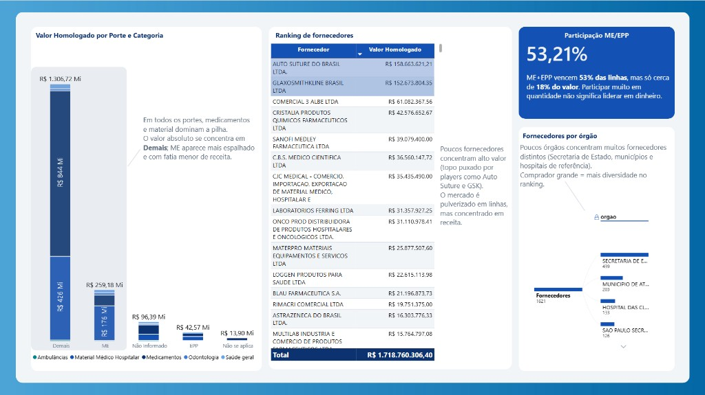
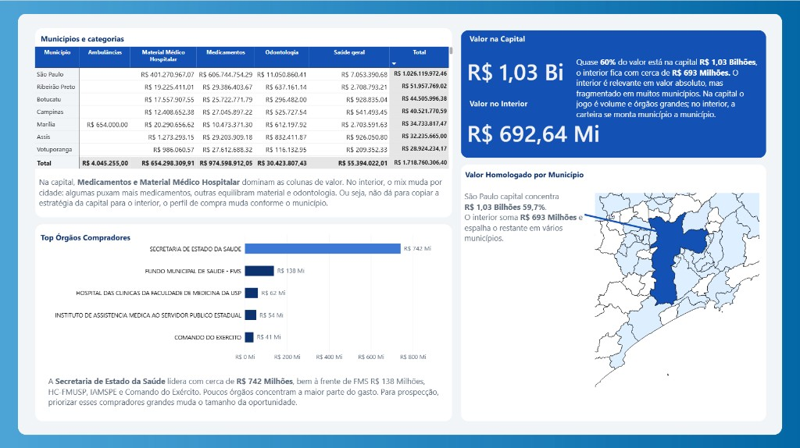
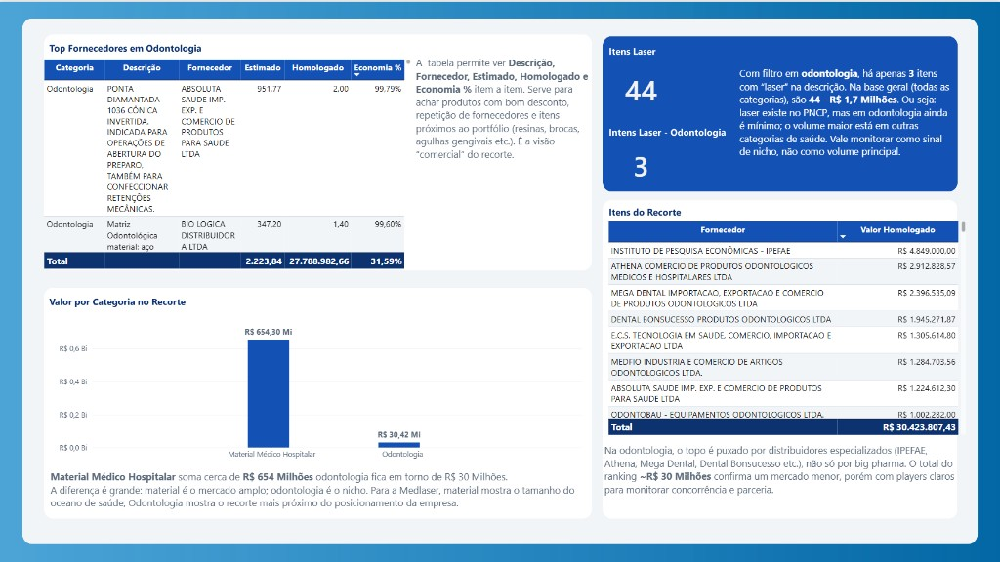

# pncp-compras-saude

Pipeline de dados públicos do [PNCP](https://www.gov.br/pncp/pt-br) focado em compras de **saúde e odontologia** em São Paulo (pregão eletrônico), com carga no Supabase e dashboard no Power BI.

Estágio / portfólio — Medlaser (BI).

<p align="center"><strong>Visão geral</strong></p>
<p align="center"></p>

<p align="center"><strong>Mercado e concorrência</strong></p>
<p align="center"></p>

<p align="center"><strong>Geografia (SP)</strong></p>
<p align="center"></p>

<p align="center"><strong>Recorte Medlaser</strong></p>
<p align="center"></p>

<p align="center"><strong>Insight — Visão geral</strong></p>
<p align="center"></p>

<p align="center"><strong>Insight — Mercado</strong></p>
<p align="center"></p>

<p align="center"><strong>Insight — Geografia</strong></p>
<p align="center"></p>

<p align="center"><strong>Insight — Medlaser</strong></p>
<p align="center"></p>

## O que o projeto faz

1. Extrai contratações publicadas na API do PNCP (SP, modalidade 6, jul–set/2026)
2. Filtra compras e itens de saúde (`vw_contratacoes_saude`, `vw_itens_saude`)
3. Baixa resultados (vencedores / preços homologados)
4. Expõe a visão analítica `pncp.vw_analitica` para o Power BI
5. Dashboard com 4 páginas operacionais + 4 de insights + tooltips de página

## Stack

| Camada | Tecnologia |
|---|---|
| Extração | Python (`requests`, SQLAlchemy) |
| Banco | Supabase (PostgreSQL) |
| Transformação | SQL (views no schema `pncp`) |
| Visualização | Power BI Desktop + Power BI Service |

## Estrutura

```
sql/              # tabelas e views
src/              # API, banco, extratores
docs/             # decisões, API e screenshots
powerbi/          # pncp.pbix (relatório)
themes/           # tema JSON do Power BI
scripts/          # utilitários (ex.: gerar insights)
```

## Setup rápido

1. Python 3.11+ e venv
2. Copie `.env` com `SUPABASE_DB_URL` (connection string do Session Pooler)
3. `pip install -r requirements.txt`
4. Rode os SQLs em ordem (`001` … `006`) no SQL Editor ou via `banco.executar_sql`
5. Extração:
   - `python src/extrair_contratacoes.py --inicio YYYY-MM-DD --fim YYYY-MM-DD`
   - `python src/extrair_itens.py`
   - `python src/extrair_resultados.py`

Detalhes da API e armadilhas de filtro: `docs/api.md` e `docs/decisoes.md`.

## Power BI

### Desktop
- Arquivo do relatório: [`powerbi/pncp.pbix`](powerbi/pncp.pbix)
- Modelo em **Import** a partir do Postgres (pooler Supabase)
- View principal: `pncp.vw_analitica`
- Tema: `themes/pncp-medlaser.json`
- Páginas: Visão geral, Mercado, Geografia (SP), Recorte Medlaser + Insights + tips (`Tip Municipio`, `Tip Fornecedor`, `Tip Item`)

### Service
- Relatório / modelo semântico publicados no workspace (nome típico: `pncp`)
- O relatório **abre e navega** com os dados publicados no `.pbix`

#### Limitação conhecida (refresh)
Ao configurar **Credenciais da fonte de dados** no Serviço, o teste/atualização pode falhar com:

```text
The remote certificate is invalid according to the validation procedure.
```

Causa: validação de certificado SSL do pooler Supabase no Power BI Service (não é senha errada; no Desktop a conexão funciona).

**Como atualizar os dados na prática**
1. Abrir o `.pbix` no Power BI Desktop
2. Atualizar
3. Publicar de novo no workspace

Refresh agendado no cloud só fica viável com gateway + certificado nas autoridades raiz da máquina do gateway (opcional; não necessário para entrega do dashboard).

Credenciais corretas (quando o Serviço aceitar / no Desktop):
- Host: `aws-0-us-east-1.pooler.supabase.com:5432`
- Database: `postgres`
- Usuário: `postgres.<project-ref>`
- Senha: trecho da `SUPABASE_DB_URL` entre `:` e `@`
- Autenticação: Básico

## Principais números (base carregada)

- ~R$ 1,72 Bi homologados · ~29 mil resultados · 292 municípios · 1.621 fornecedores
- Economia média útil ~30,45%
- Odontologia ~R$ 30 Mi · Material ~R$ 654 Mi
- Itens com “laser” na descrição: 44 no geral · 3 só em odontologia

## Documentação

- `docs/api.md` — endpoints e comportamentos do PNCP
- `docs/decisoes.md` — filtros, RLS, economia útil, Power BI Service
- `docs/screenshots/` — capturas das 8 páginas do dashboard
